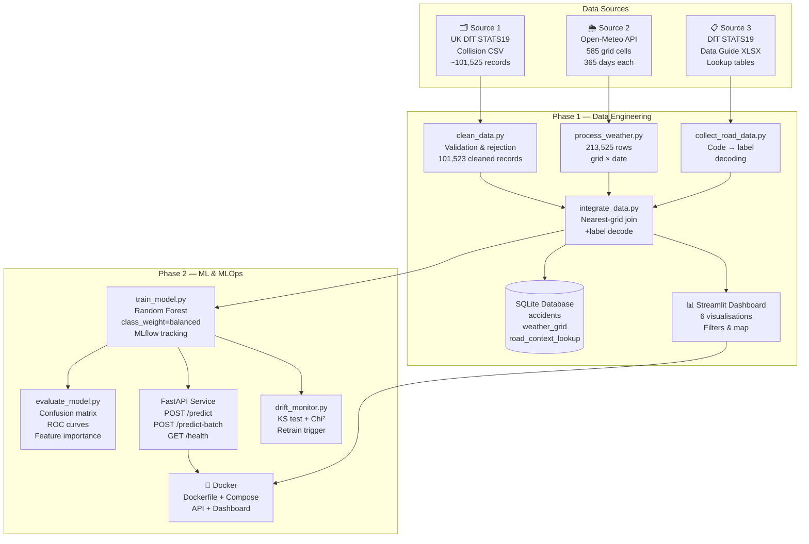

# docs/architecture.md
# Project Architecture — Traffic Accident Severity Analytics

## Overview

This project implements a complete end-to-end data engineering and machine
learning pipeline for UK road accident severity prediction. It is structured
in two phases:

- **Phase 1**: Data Engineering & Analytics (ingestion → cleaning → integration → database → dashboard)
- **Phase 2**: Machine Learning & MLOps (training → evaluation → API → drift monitoring → Docker)

---

## Architecture Diagram



---

## Phase 1 Detail

### Stage A — Ingestion
| Script | Input | Output |
|--------|-------|--------|
| `clean_data.py` | `data/raw/accidents/*.csv` | `data/cleaned/accidents_cleaned.csv` |
| `fetch_weather.py` | Open-Meteo API | `data/raw/weather/*.json` (585 files) |
| `process_weather.py` | `data/raw/weather/*.json` | `data/cleaned/weather_processed.csv` |
| `collect_road_data.py` | DfT STATS19 guide URL | `data/raw/road_context/`, `data/cleaned/road_context_lookup.csv` |

### Stage B — Integration
```
accidents_cleaned.csv  ──┐
weather_processed.csv  ──┤→ integrate_data.py → accident_severity_dataset.csv
road_context_lookup.csv ─┘
```

**Weather join**: Accident lat/lon → round to nearest 0.25° → match on (grid_lat, grid_lon, date)

**Road context join**: Integer code columns → map through lookup dict → add `_label` columns

### Stage C — Database
- Engine: SQLite (default) or PostgreSQL (via env var `DB_TYPE=postgres`)
- Tables: `accidents`, `weather_grid`, `road_context_lookup`
- Script: `load_database.py`
- Schema: `sql/schema.sql`

---

## Phase 2 Detail

### Model
- Algorithm: `RandomForestClassifier(n_estimators=200, class_weight='balanced')`
- Features: 10 numeric + 6 categorical = 16 input features
- Target: `collision_severity` (1=Fatal, 2=Serious, 3=Slight)
- Split: 80/20 stratified, seed=42
- Saved: `models/severity_model.pkl` (full sklearn Pipeline)

### MLflow
- Tracking URI: local `mlruns/` directory
- Logged: parameters, accuracy, macro-F1, per-class F1/precision/recall, model artefact
- UI: `mlflow ui --backend-store-uri mlruns`

### API
- Framework: FastAPI + Uvicorn
- Endpoints: `GET /`, `/health`, `/model-info`, `POST /predict`, `/predict-batch`
- Docs: `http://localhost:8000/docs`

### Drift Monitoring
- Method: KS test (numeric) + Chi-square (categorical)
- Reference: Jan–Jun 2025 (demonstration split)
- Current: Jul–Dec 2025
- Trigger: sustained KS > 0.15 on ≥2 top features + ≥1,000 new labelled records

---

## Directory Structure

```
Traffic_Accident_Project/
├── data/
│   ├── raw/
│   │   ├── accidents/          # DfT STATS19 CSV (source 1)
│   │   ├── weather/            # 585 Open-Meteo JSON files (source 2)
│   │   └── road_context/       # DfT data guide XLSX (source 3)
│   ├── staging/                # Grid locations, test split
│   ├── cleaned/                # Processed CSVs, integrated dataset
│   └── rejected/               # Rejected records with reasons
├── scripts/                    # All data engineering & ML scripts
├── dashboard/app.py            # Streamlit dashboard
├── api/                        # FastAPI application
├── models/                     # Trained model + evaluation artefacts
│   └── evaluation/             # Confusion matrix, ROC, feature importance
├── mlruns/                     # MLflow experiment tracking
├── sql/                        # Schema + analytics queries
├── tests/                      # pytest test suites
├── docs/                       # Documentation
├── logs/                       # Pipeline logs and reports
├── Dockerfile
├── docker-compose.yml
└── requirements.txt
```
